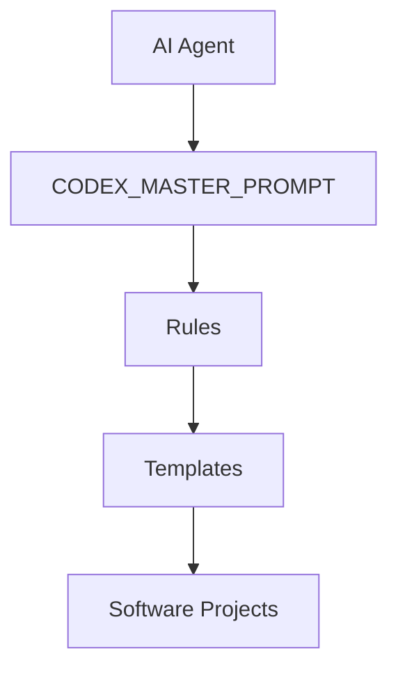
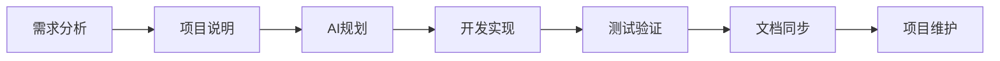

[](LICENSE)
[]()
[]()

# Codex Development Framework

> 面向 AI Agent 的软件工程开发框架

Codex Development Framework 是一个帮助 AI Agent 参与软件工程流程的开发框架。

它通过：

- 项目上下文管理
- 工程规则体系
- 文档模板系统
- 标准化开发流程

让 AI 不只是生成代码，而是在结构化流程中参与软件开发。

---

# 为什么需要这个框架？

随着 AI 编程助手的发展，代码生成已经越来越容易。

但是高质量的软件开发不仅需要生成代码，还需要：

- 明确的项目目标
- 稳定的工程规范
- 清晰的架构设计
- 持续维护的项目上下文
- 完整的验证流程

Codex Development Framework 希望解决的问题：

> 如何让 AI Agent 从“代码生成工具”转变为“软件工程协作者”。

---

# 核心能力

## 🤖 AI Agent 工作流

帮助 AI Agent 理解：

- 项目目标
- 当前状态
- 技术约束
- 开发规则
- 验证要求


## 📚 工程规则系统

通过 `rules/` 管理：

- 需求分析
- 开发流程
- 测试规范
- 调试方法
- Git 工作流
- 安全规范


## 🧩 项目模板系统

通过 `templates/` 提供：

- AGENTS.md
- PROJECT_BRIEF.md
- PROJECT_STATUS.md
- DESIGN.md
- README.md

帮助快速建立适合 AI 协作的软件项目结构。


---

# 系统架构

Codex Development Framework 采用分层结构，让 AI Agent 在明确规则和上下文中参与软件开发。



## 架构说明

### CODEX_MASTER_PROMPT.md

中央入口规范。

负责：

- 定义 AI Agent 工作方式
- 管理规则读取
- 指导开发流程


### rules/

工程规则库。

包含：

- 需求规则
- 开发规则
- 测试规则
- 安全规则


### templates/

项目模板库。

用于：

- 创建项目文档
- 统一项目结构
- 建立 AI Agent 上下文


### Software Projects

实际开发项目。

每个项目保持：

- 独立代码
- 独立文档
- 独立上下文

---

# AI 辅助开发流程

推荐的软件工程流程：



核心理念：

```
Context

↓

Rules

↓

Planning

↓

Implementation

↓

Verification
```

AI Agent 不应该只是：

```
需求 → 代码
```

而应该参与：

```
理解上下文

↓

遵循规则

↓

规划方案

↓

实现功能

↓

验证结果
```

---

# 快速开始

## 1. 克隆仓库

```bash
git clone https://github.com/LinksOnlining/Codex-Development-Framework.git
```

进入目录：

```bash
cd Codex-Development-Framework
```


## 2. 阅读核心规范

首先阅读：

```
CODEX_MASTER_PROMPT.md
```

了解：

- AI Agent 工作方式
- 规则体系
- 开发流程


## 3. 查看规则

进入：

```
rules/
```

根据需求读取：

- `REQUIREMENTS.md` —— 需求分析
- `DEVELOPMENT.md` —— 开发流程
- `TESTING.md` —— 测试验证
- `SAFETY.md` —— 安全规范


## 4. 创建项目

使用：

```
templates/
```

中的模板：

```
AGENTS.md

PROJECT_BRIEF.md

PROJECT_STATUS.md
```


## 5. 开始 AI 辅助开发

推荐流程：

```
Context

↓

Rules

↓

Planning

↓

Implementation

↓

Verification
```

---

# 项目结构

```
Codex-Development-Framework/

├─ CODEX_MASTER_PROMPT.md
│
├─ rules/
│   ├─ REQUIREMENTS.md
│   ├─ DEVELOPMENT.md
│   ├─ TESTING.md
│   └─ SAFETY.md
│
├─ templates/
│
├─ examples/
│   └─ sample-project/
│
├─ docs/
│
├─ archive/
│
├─ CONTRIBUTING.md
│
├─ CHANGELOG.md
│
└─ README.md
```

---

# 文档

详细文档：

- [系统架构](docs/architecture.md)
- [开发工作流程](docs/workflow.md)

---

# 贡献

欢迎参与改进：

- 提交 Issue
- 提供功能建议
- 提交 Pull Request
- 分享实际使用案例

详细说明：

[CONTRIBUTING.md](CONTRIBUTING.md)

---

# 版本记录

当前版本：

```
v1.0.0
```

更新记录：

[CHANGELOG.md](CHANGELOG.md)

---

# 设计理念

优秀的软件开发不仅需要代码生成能力。

还需要：

```
上下文

↓

规则

↓

规划

↓

实现

↓

验证
```

Codex Development Framework 希望探索 AI Agent 时代的软件工程方法。

---

# License

MIT License