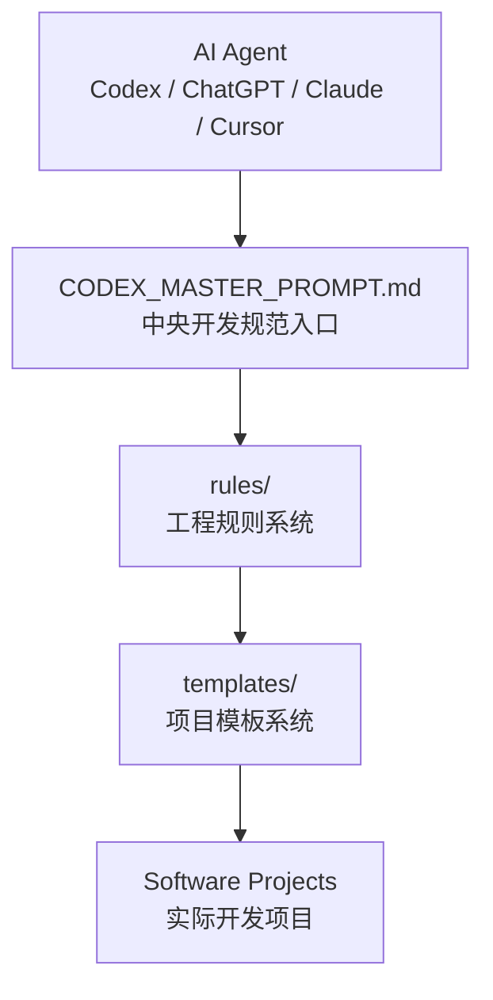
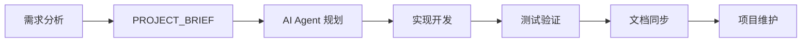

[](LICENSE)
[]()
[]()
# Codex 中央开发规范库

本目录是所有软件项目共用的只读规范库与文档模板库，不是可直接开发或整目录复制的项目骨架。

# Documentation

详细文档：

- [系统架构](docs/architecture.md)
- [开发工作流程](docs/workflow.md)

这些文档介绍框架设计理念、核心组件关系以及推荐的软件开发流程。

# Quick Links

- [总控规范](CODEX_MASTER_PROMPT.md)
- [开发规则](rules/)
- [项目模板](templates/)
- [示例项目](examples/sample-project/)
- [系统架构](docs/architecture.md)
- [开发流程](docs/workflow.md)

## 使用方式

新项目由工作区规则触发需求访谈。需求达到约 95% 理解把握并经用户确认后，Codex 才能：

1. 从 `templates/` 读取所需模板；
2. 在 `D:\AI_Workspace\Projects` 下创建与本目录同级的项目；
3. 为新项目生成自己的文档和代码；
4. 仅在需要具体规则时读取 `rules/` 中对应主题。

已有项目优先读取项目自己的 `AGENTS.md`、`PROJECT_BRIEF.md`、`PROJECT_STATUS.md`，再检查 `git status`、`git diff` 和当前任务相关文件。普通任务不得默认全文读取 `CODEX_MASTER_PROMPT.md` 或本库全部文件。

## 快速开始

### 1. 克隆项目

```bash
git clone https://github.com/LinksOnlining/Codex-Development-Framework.git
```

进入目录：

```bash
cd Codex-Development-Framework
```

---

### 2. 阅读核心规范

首先阅读：

```
CODEX_MASTER_PROMPT.md
```

了解：

- AI Agent 工作方式
- 规则系统
- 软件开发流程

---

### 3. 查看开发规则

进入：

```
rules/
```

根据需求读取对应规则：

- 需求分析 → `REQUIREMENTS.md`
- 开发流程 → `DEVELOPMENT.md`
- 测试验证 → `TESTING.md`
- 安全规范 → `SAFETY.md`

---

### 4. 创建新项目

使用：

```
templates/
```

中的模板创建项目文档：

```
AGENTS.md

PROJECT_BRIEF.md

PROJECT_STATUS.md
```

---

### 5. 开始 AI 辅助开发

将项目上下文、规则和文档提供给 AI Agent。

推荐流程：

```
Context

↓

Rules

↓

Planning

↓

Implementation

↓

Verification
```

## 目录

```text
AI_Project_Template/
├─ CODEX_MASTER_PROMPT.md   总控、入口与规则索引
├─ templates/               新项目文档模板
├─ rules/                   按主题拆分的详细规则
├─ archive/                 已淘汰内容；不参与当前流程
└─ README.md                本说明
```

## 自动与按需读取

- 项目根目录的 `AGENTS.md` 由 Codex 自动发现；`templates/AGENTS.template.md` 用于生成它。
- `PROJECT_BRIEF.md` 与 `PROJECT_STATUS.md` 是项目启动时的首要上下文。
- `DESIGN.md`、`README.md`、`CHANGELOG.md`、项目级 `CODEX.md` 和中央 `rules/` 均按任务需要读取。
- `CODEX_MASTER_PROMPT.md` 仅用于规则不明确、新的大阶段、复杂决策、重大架构变化、高风险修改或全面审查。

## 系统架构

Codex Development Framework 通过分层结构帮助 AI Agent 参与软件工程流程。



### 架构说明

- **CODEX_MASTER_PROMPT.md**
  - AI Agent 工作流程入口
  - 规则路由和方法论定义

- **rules/**
  - 存储开发规范
  - 包括需求、开发、测试、安全等规则

- **templates/**
  - 提供项目初始化模板
  - 帮助快速建立标准项目结构

- **Software Projects**
  - 实际开发项目
  - 保持独立代码和项目上下文

## AI 辅助开发流程

推荐的软件开发流程：



核心理念：

```
上下文
 ↓
规则
 ↓
规划
 ↓
实现
 ↓
验证
```

AI Agent 不只是生成代码，而是在结构化流程中参与软件工程。

## 维护

普通项目不得修改本库。只有用户明确要求维护中央规范时才可变更；先合并到对应的单一事实来源，再归档被替代内容。新增规则前先搜索重复项。`archive/` 仅供追溯，不作为有效规则来源。
